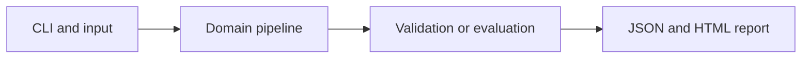

# Customer Segmentation with K-Means++

Discover customer groups and evaluate clustering stability using independent fits.

**Category:** ML

**Execution:** Actual local algorithm or workflow; no external model service required.

## Run

```sh
python -m venv .venv
# Windows: .venv\Scripts\activate
# macOS/Linux: source .venv/bin/activate
python -m pip install -r requirements.txt
python app.py
python -m unittest discover -v
```

Open `results/report.html` after running. Python 3.10+ is required. Use `--help` for input and seed options.

## Architecture



## Algorithm

Standardize features using training statistics. K-means++ chooses dispersed initial centers; Lloyd iterations alternate nearest-center assignment and mean updates. Empty centers retain their previous position.

## Evaluation

Compare k=2,3,4,5 with a silhouette estimate on held-out rows. Report adjusted Rand index using synthetic labels solely as an external diagnostic, not for fitting.

## Limitations

Silhouette favors compact Euclidean clusters. Segment IDs have no inherent business meaning; synthetic separation makes the example easy.

## Documentation

- [PDF project guide](PROJECT_GUIDE.pdf)
- [Editable guide](GUIDE.md)
- [Model and system card](MODEL_CARD.md)
- [Measured results](results/metrics.json)
- [Test output](TEST_RESULTS.txt)

## Extend it

Add mixed feature handling, bootstrap stability, segment profiles and a practical strategy for naming segments without using hidden labels.

AI-assisted educational project with synthetic data. Review, customize and explain your own contribution accurately. MIT license.
